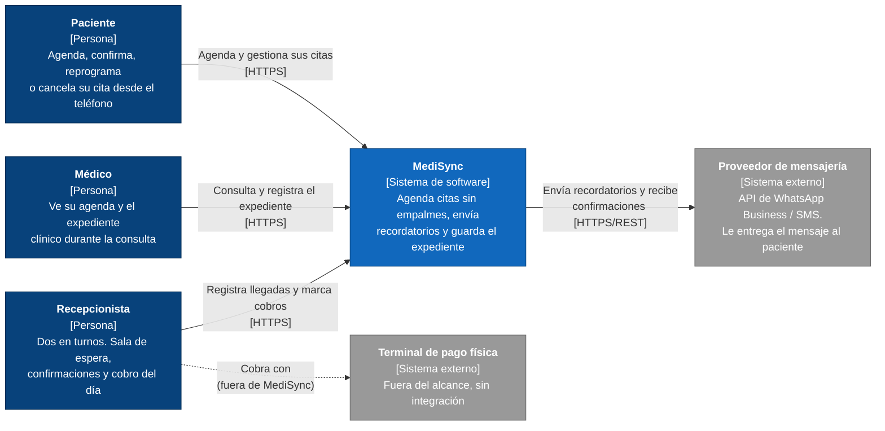
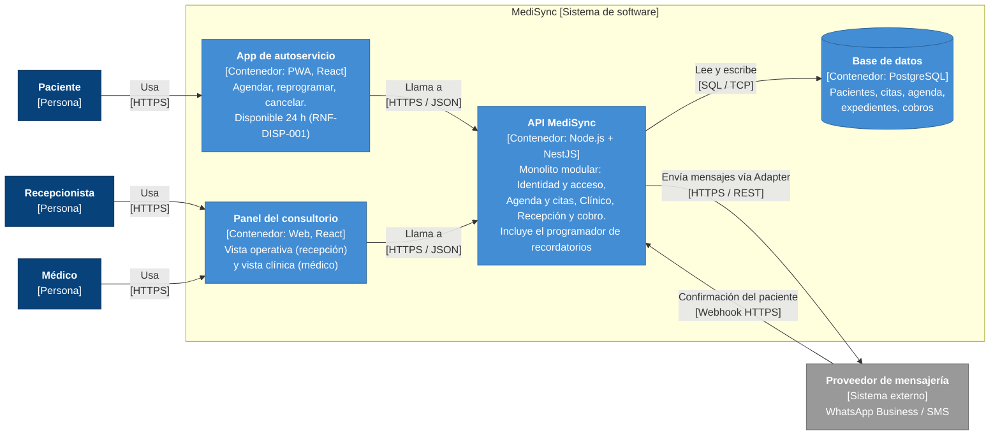
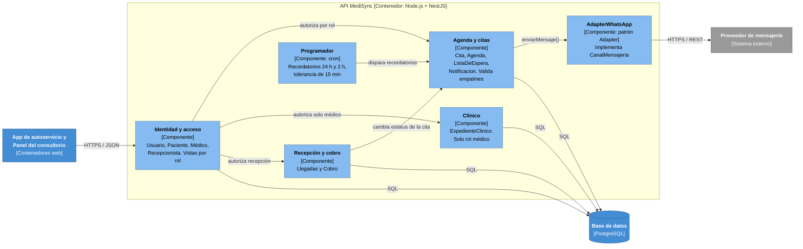

# Arquitectura de MediSync (modelo C4)

Este documento describe la arquitectura de MediSync en tres niveles del modelo C4: contexto, contenedores y componentes. Las decisiones que explican por qué quedó así están en los registros de decisión de la carpeta `docs/arch/` (`arch/adr-001-monolito-modular.md` y `arch/adr-002-adapter-mensajeria.md`).

## Nivel 1 · Diagrama de contexto

MediSync es un solo sistema que usan tres tipos de persona y que habla con un único sistema externo: el proveedor de mensajería (SMS/WhatsApp) para recordatorios y confirmaciones (RF-008).

La terminal de pago aparece en el diagrama a propósito, pero **sin flecha hacia MediSync**: RF-012 deja claro que el sistema no la reemplaza ni se integra con ella, solo refleja que la recepcionista ya cobró ahí.

## Nivel 2 · Diagrama de contenedores

MediSync es un **monolito modular** (ver ADR-001): una sola API desplegable, dividida por dentro en los cuatro módulos que salieron del análisis (Identidad y acceso, Agenda y citas, Clínico, Recepción y cobro), más dos aplicaciones web y una base de datos.

## Nivel 3 · Diagrama de componentes de la API

Por dentro, la API son los cuatro módulos del monolito modular (ADR-001) más el Adapter de mensajería (ADR-002) y el programador que dispara recordatorios y revisa la tolerancia de 15 minutos. Las flechas son llamadas a función dentro del mismo proceso, no viajes por red.

## Cómo concuerda con el resto del modelo

- Los cuatro módulos de la API son los mismos que agrupan las clases del diagrama de clases (`docs/uml-medisync.md`).
- La flecha "Envía mensajes vía Adapter" es la interfaz `CanalMensajeria` y su implementación `AdapterWhatsApp` del diagrama de clases, y aparece como mensaje `enviarMensaje()` en el diagrama de secuencia (`docs/uml-medisync.md`).
- El webhook de confirmación es lo que dispara la transición `Agendada → Confirmada` en el diagrama de estados de la cita (`docs/uml-medisync.md`).
