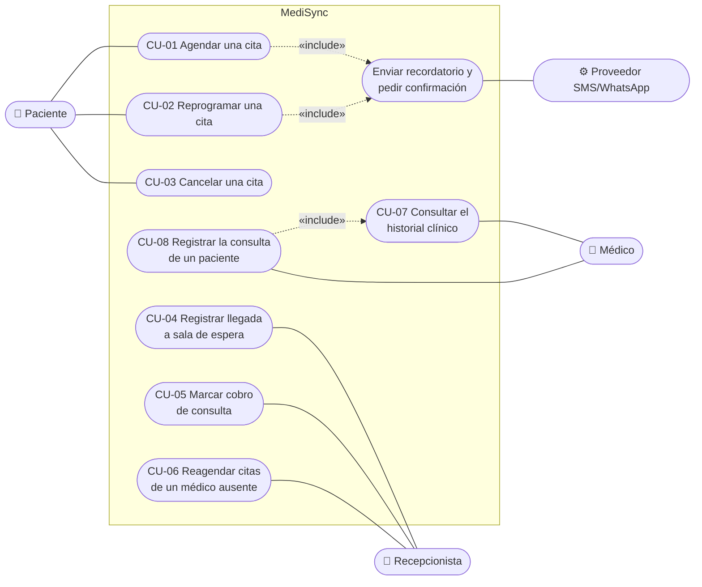

# Diagrama de casos de uso · MediSync

Versión 2 del diagrama de casos de uso (la versión 1 está en `casos-de-uso.drawio`). Agrega el «include» de recordatorios y al proveedor de SMS/WhatsApp como actor secundario. El detalle de cada caso está en [`../casos-de-uso.md`](../casos-de-uso.md). Mermaid no tiene diagrama de casos de uso nativo, así que se dibuja con un flowchart: los actores van fuera del límite del sistema y cada caso de uso es un óvalo dentro.

## Trazabilidad

| Caso de uso | Requisitos que realiza |
|---|---|
| CU-01 Agendar una cita | RF-003, RF-004, RF-008, RF-010, RF-016 |
| CU-02 Reprogramar una cita | RF-003, RF-004, RF-005 |
| CU-03 Cancelar una cita | RF-006, RF-007, RF-009 |
| CU-04 Registrar llegada a sala de espera | RF-002, RF-011 |
| CU-05 Marcar cobro de consulta | RF-011, RF-012 |
| CU-06 Reagendar citas de un médico ausente | RF-003, RF-004, RF-015 |
| CU-07 Consultar el historial clínico | RF-013 |
| CU-08 Registrar la consulta de un paciente | RF-013, RF-014 |
| Todos | RF-001 (control de acceso por rol) |
