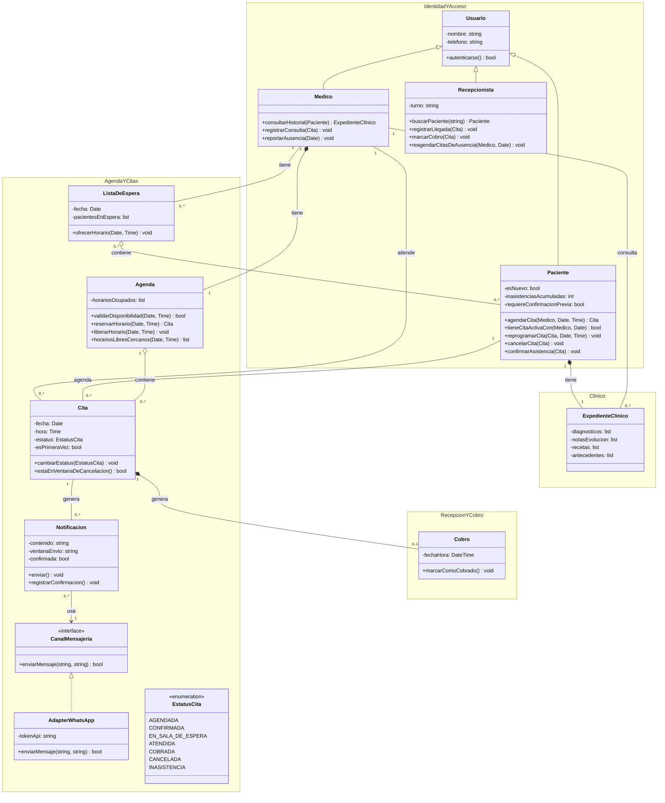
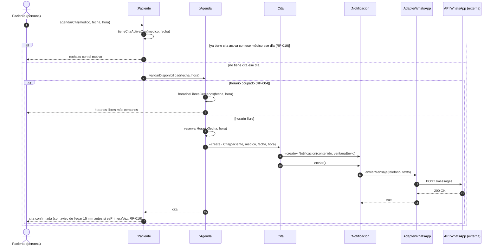
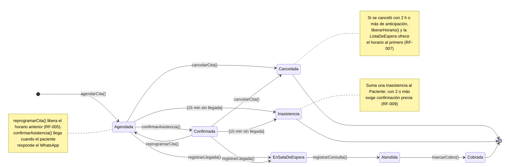

# Modelo UML de MediSync

Modelo estructural (clases) y de comportamiento (secuencia y estados), en texto de Mermaid.

## Diagrama de clases (versión 2)

Versión 2, corregida después de hacer el diagrama de secuencia de CU-01 Agendar una cita. Los cambios contra la versión 1 están al final de esta sección.

### Qué cambió contra la versión 1 (y por qué)

Todo esto lo descubrí al hacer el diagrama de secuencia de CU-01: había mensajes que necesitaba mandar y que no existían como operación en ninguna clase.

| Cambio | Por qué |
|---|---|
| `Agenda.reservarHorario(Date, Time)` nueva | La v1 sabía liberar un horario pero no ocuparlo. Sin esto, nadie marcaba el horario como tomado al crear la cita. |
| `Agenda.horariosLibresCercanos(Date, Time)` nueva | RF-004 pide mostrar los horarios libres más cercanos cuando el elegido está ocupado. Ninguna clase lo sabía hacer. |
| `Paciente.tieneCitaActivaCon(Medico, Date)` nueva | RF-010 (no dos citas activas con el mismo médico el mismo día) no tenía quién la validara. |
| `agendarCita()` ahora recibe `(Medico, Date, Time)` | En la v1 no recibía nada: no había forma de saber qué horario se pedía. |
| Interfaz `CanalMensajeria` y clase `AdapterWhatsApp` nuevas | `Notificacion.enviar()` necesitaba a alguien a quien mandarle el mensaje. El Adapter ya estaba decidido en ADR-002, pero no estaba en el diagrama. |
| `EstatusCita` como enumeración | En la v1 el estatus era un `string` libre; el diagrama de estados mostró que son exactamente siete valores. |
| `telefono` subió de `Paciente` a `Usuario` | Recepción y médico también reciben avisos (RF-009 notifica a recepción). |
| `ListaDeEspera` ahora sabe su `fecha` | La lista es por médico y por fecha (RF-007); sin la fecha no se sabe a qué día pertenece. |
| Multiplicidad `ListaDeEspera "0..*" o-- "0..*" Paciente` | En la v1 decía que cada paciente solo podía estar en una lista; un paciente puede esperar en la de dos fechas distintas. |
| `Cobro` perdió el atributo `estatus` | Era redundante: que exista el `Cobro` ya significa que se cobró, y el estatus vive en `Cita` (`COBRADA`). |

## Diagrama de secuencia · CU-01 Agendar una cita

Es el caso de uso más importante: es el que ataca directamente el problema central (empalmes y citas duplicadas) y realiza cinco requisitos (RF-003, RF-004, RF-008, RF-010, RF-016).

Cada mensaje entre objetos corresponde a una operación del diagrama de clases (`docs/uml-medisync.md`), con el mismo nombre y los mismos parámetros.

### Concordancia con el diagrama de clases

| Mensaje en la secuencia | Operación en el diagrama de clases |
|---|---|
| 1 `agendarCita(medico, fecha, hora)` | `Paciente +agendarCita(Medico, Date, Time) Cita` |
| 2 `tieneCitaActivaCon(medico, fecha)` | `Paciente +tieneCitaActivaCon(Medico, Date) bool` |
| `validarDisponibilidad(fecha, hora)` | `Agenda +validarDisponibilidad(Date, Time) bool` |
| `horariosLibresCercanos(fecha, hora)` | `Agenda +horariosLibresCercanos(Date, Time) list` |
| `reservarHorario(fecha, hora)` | `Agenda +reservarHorario(Date, Time) Cita` |
| `enviar()` | `Notificacion +enviar() void` |
| `enviarMensaje(telefono, texto)` | `CanalMensajeria +enviarMensaje(string, string) bool`, implementada por `AdapterWhatsApp` |

`POST /messages` no es una operación del diagrama de clases a propósito: es la API externa del proveedor, y justamente el Adapter existe para que ninguna clase de MediSync la conozca (ADR-002).

## Diagrama de estados · Cita

Elegí el de estados y no el de actividad porque lo que más reglas de negocio tiene en MediSync es la vida de una cita: tolerancia de 15 minutos, cancelación con 2 horas, inasistencias, cobro. Los estados son exactamente los valores de la enumeración `EstatusCita` del diagrama de clases.

### Concordancia con el diagrama de clases

| Transición | Operación que la dispara |
|---|---|
| `[*] → Agendada` | `Paciente.agendarCita()` |
| `Agendada → Confirmada` | `Paciente.confirmarAsistencia()`, que llega por el webhook del proveedor (C4, contenedores) |
| `→ Cancelada` | `Paciente.cancelarCita()` |
| `→ EnSalaDeEspera` | `Recepcionista.registrarLlegada()` |
| `EnSalaDeEspera → Atendida` | `Medico.registrarConsulta()` |
| `Atendida → Cobrada` | `Recepcionista.marcarCobro()` |
| Todas | internamente llaman a `Cita.cambiarEstatus(EstatusCita)` |
